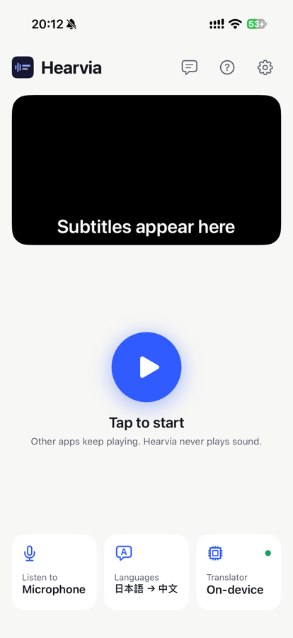
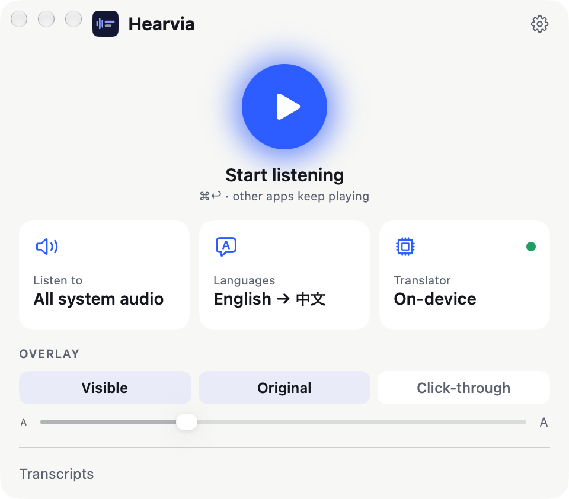

# Hearvia

**Live translated subtitles for anything you hear, on iPhone and Mac.** Hearvia listens to other apps' audio or the microphone and shows subtitles on top of whatever you're doing: videos, podcasts, calls, or the person in front of you.

  
  &nbsp;&nbsp;
  

  

## Features

- **Hears other apps.** On iPhone, a floating window shows subtitles over videos, podcasts and calls. On Mac, an overlay follows all system audio or a single app.
- **Never gets in the way.** Hearvia doesn't play sound or pause anything; what you're watching keeps playing.
- **Your choice of translator:**
  - **On-device:** Apple's speech recognition and translation. Free, private, and offline once the languages are downloaded. The spoken language can be detected automatically among the ones you've downloaded.
  - **OpenAI Realtime** and **Gemini Live:** cloud translators with the lowest lag, using your own API key.
  - **Local model (experimental):** Apple speech recognition, then each sentence goes to a model you run yourself with Ollama, LM Studio, Unsloth Studio or another OpenAI-compatible server, on your Mac or your network.
- **Transcripts** of each session stay on your device, or sync through your own iCloud to your other devices if you turn it on.
- **Quick start** on iPhone from a widget, Control Center, Shortcuts or the app icon.
- **Private by default:** no accounts, no analytics, no tracking. See the [privacy policy](https://hewigovens.github.io/hearvia/privacy.html).

## Get Hearvia

Hearvia is in internal testing on TestFlight; a public beta is coming. It needs iOS 27 or macOS 27. Updates are on the [website](https://hewigovens.github.io/hearvia/).

To build it yourself, see [CONTRIBUTING.md](CONTRIBUTING.md).

## Feedback

Report bugs and ideas in [GitHub issues](https://github.com/hewigovens/hearvia/issues).

## License

[BSL 1.1](LICENSE): free to use, modify and redistribute; paid app store distribution requires permission. Converts to Apache-2.0 on 2030-10-17.
